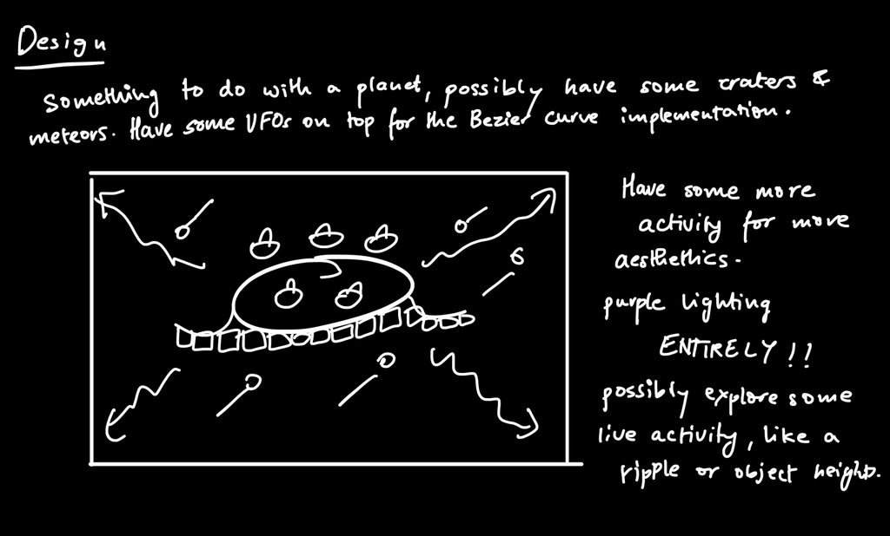
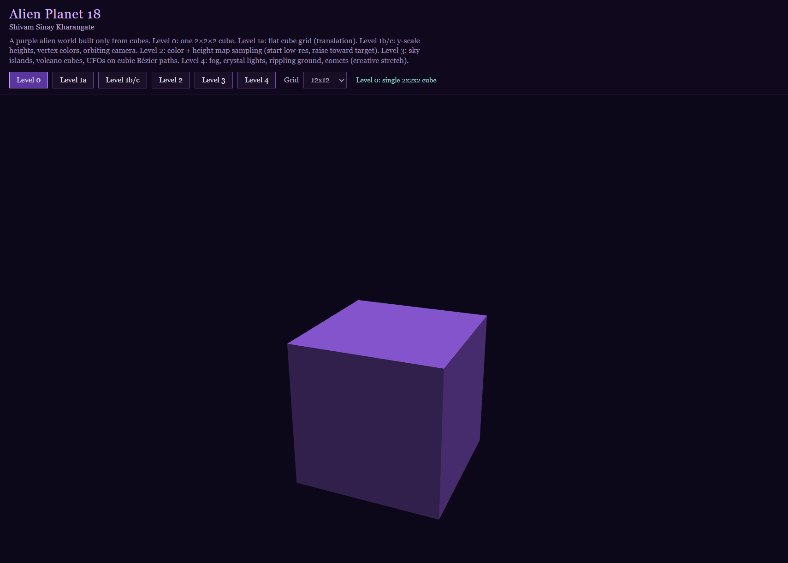
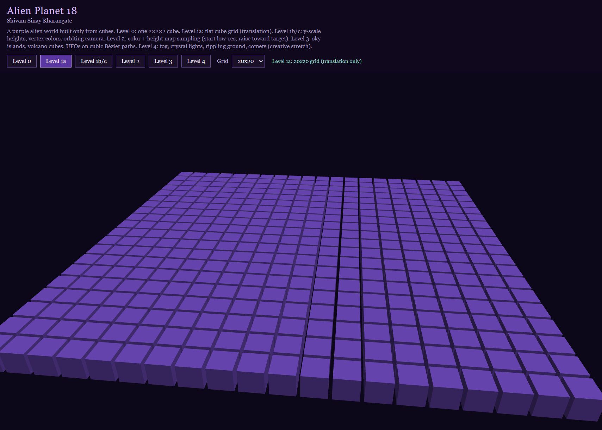
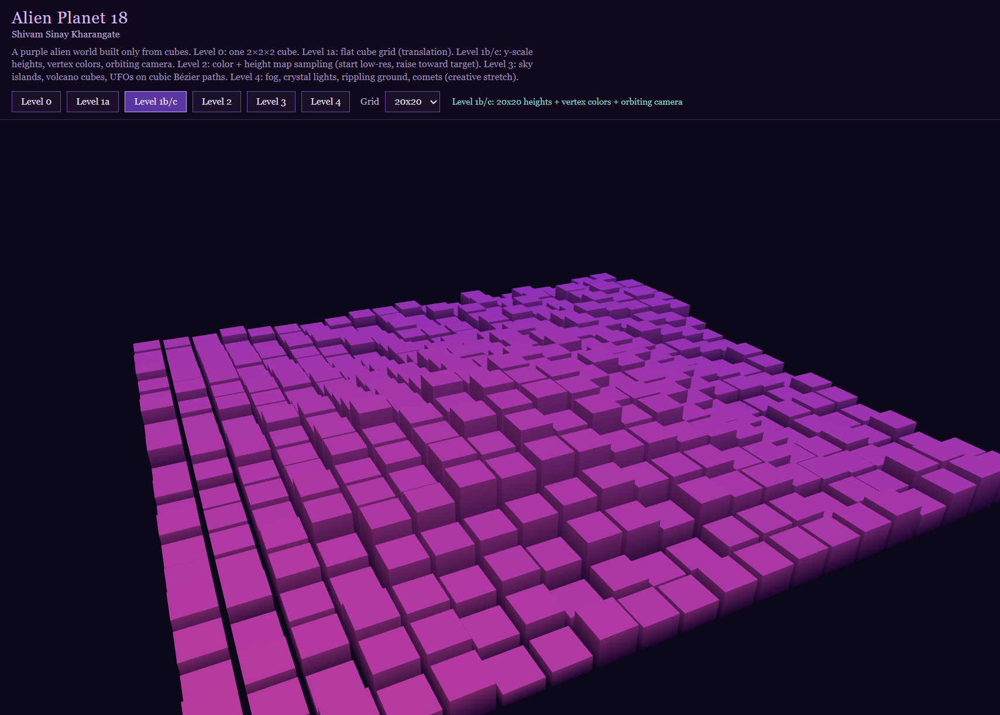
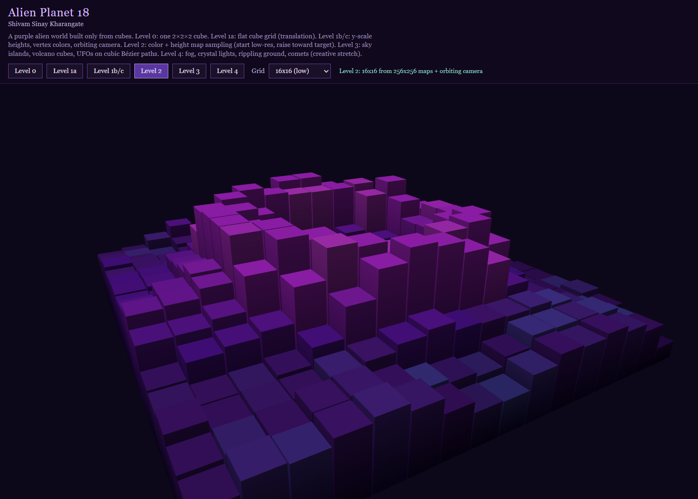
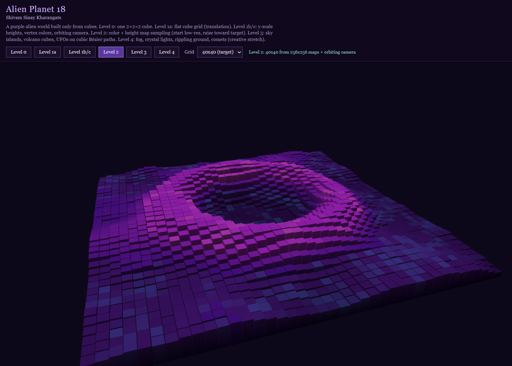
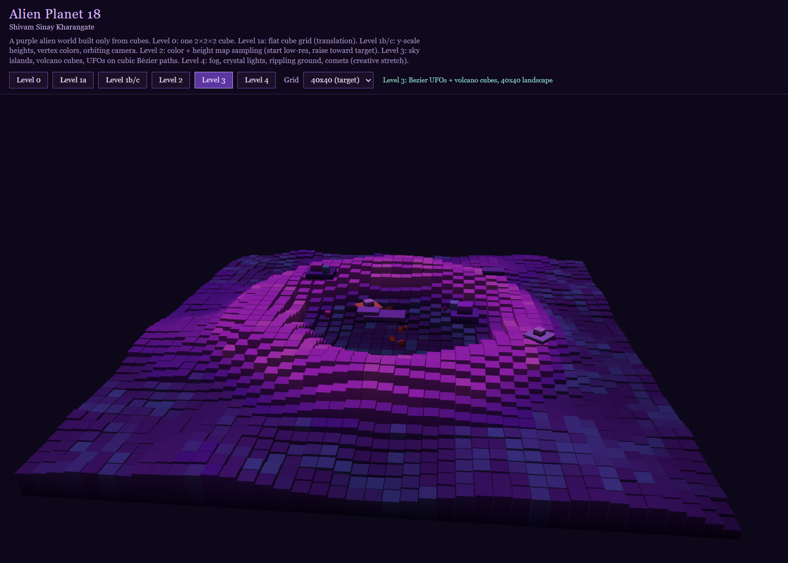
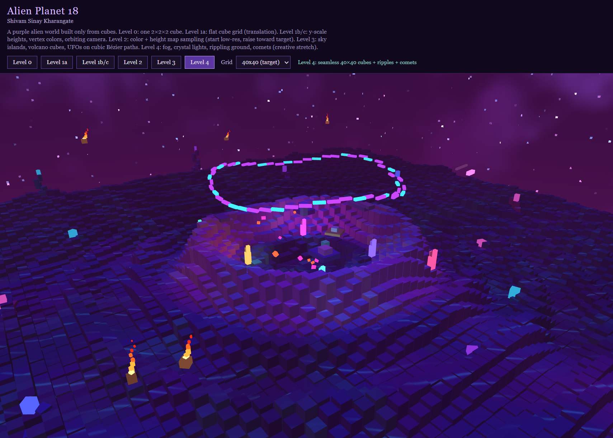
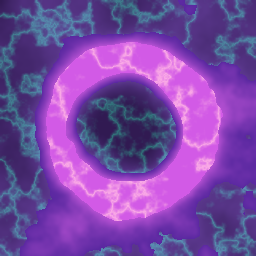
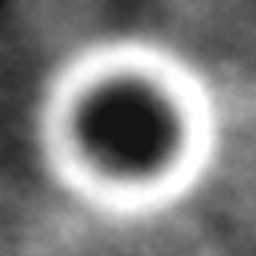

# Project 2 Design and Documentation: Shivam Sinay Kharangate

## Alien Planet 18

Source code: https://github.com/ShivamKGate/ComputerGraphics2026  
Live application: https://shivamkgate.github.io/ComputerGraphics2026/proj2/  
Code files: https://github.com/ShivamKGate/ComputerGraphics2026/blob/main/proj2/index.html and `index.js`  
Demo video (Download required): [CG2026-Project2Demo.mp4](CG2026-Project2Demo.mp4)

## Design

The idea for this project was a simple 3D alien planet made only out of cubes in WebGL, with no Three.js or other graphics frameworks. I wanted a purple world that still felt creative with some good elements to it to make it look as aesthetically pleasing as possible. The landscape sits on the ground plane, the heights and colors change by level, and later I added sky objects and a UFO that moves on a curve. Level 4 was extra exploration on top of that. The design I had in mind for this project is shown below.

### The Controls

The page has a header with the title, my name, a short description of the levels, and the buttons. The canvas takes up the rest of the screen. The camera slowly rotates around the planet and always looks toward the center, so you can see the whole scene without needing WASD for this project.

| Control | What it does |
| --- | --- |
| Level 0 | Just one 2x2x2 cube, the starter scene |
| Level 1a | A flat grid of cubes on the ground (moved with translation) |
| Level 1b/c | Same grid, but cubes get different heights and colors; camera keeps orbiting |
| Level 2 | Landscape built from a color image and a grayscale height image |
| Level 3 | Adds sky islands, a small volcano of cubes, and UFOs that follow a Bézier path |
| Level 4 | Extra look: lighting adjustments, skybox, glowing crystals, rippling ground, mini comets |
| Grid dropdown | Lets you change how many cubes are in the grid (start lower, go higher) |

**Level 0: the single 2x2x2 cube**

**Level 1a: the flat grid (translation)**

**Level 1b/c: heights, vertex colors, orbiting camera**

**Level 2: image sampling for low res**

**Level 2: higher grid resolution on 40x40**

**Level 3: Bézier curved UFOs, sky islands, volcano cubes**

**Level 4: creative stretch (lighting, skybox, crystals, ripples, comets)**

## Implementation

Everything was built with HTML, CSS, JavaScript, and WebGL. The main files are `index.html` and `index.js` that are within this project repo folder for proj2. The only model that I was allowed to use was just a cube, so every object in the scene is that same cube moved, stretched, or rotated into place.

### The cube model

I described one cube in its own space as corners and faces, the same idea as the cube activity that we did in class. WebGL draws it as triangles. Then for every cube in the world I changed a model matrix, so I could reuse the same geometry instead of making a new mesh each time.

### Transforms and the camera

For each cube I scaled it and then translated it into the world. The camera uses a look at style view matrix so it points at the middle of the landscape, and a perspective matrix so farther things look smaller. Level 1d is not its own button. It is the orbiting camera path that updates every frame while you look at Levels 1a / 1b/c (and later levels too).

### Level 0 and Level 1

Level 0 is just one cube scaled to 2x2x2 to confirm that the WebGL setup worked.

Level 1a lays cubes out in a grid on the x-z plane. That is mostly translation.

Level 1b scales those cubes in y so some are taller than others. At first I used a simple procedure for the heights.

Level 1c assigns colors at the vertices. The fragment shader fills in the faces between those colors, which is the interpolation we talked about in class.

### Level 2

Outside the program I used AI to generate two PNG files: a color map and a grayscale height map. The program loads them, samples a pixel for each grid cell, and uses that for the cube’s color and height. If the grid is smaller than the image, I stretched across the image so each cube still gets a color and a gray value. The gray goes from 0 to 255, and I mapped that into a real height in the scene. The grid dropdown starts lower and can go up toward a higher target so it still runs okay on a normal laptop.

**Color map used for Level 2**

**Height map used for Level 2 (grayscale)**

### Level 3

For the skyscape I built small objects out of cubes again, like floating islands and a UFO made from a few scaled cubes. The UFO moves with a cubic Bézier curve. I picked four control points, and as t goes from 0 to 1 the craft follows that path. When it finishes the path or gets far away, I sent it back to the start so it loops. I also added cubes coming out of the crater to kind of show off a tiny volcano.

The Bézier function I used is the usual cubic one:

B(t) = (1-t)³P₀ + 3(1-t)²t P₁ + 3(1-t)t² P₂ + t³ P₃

### Level 4

Level 4 is where I went past the minimum. I still only drew cubes, but I experimented with stronger lighting, glowing crystal cubes, a ground ripple across the surface, and mini comets with little fire-cube trails. It still connects to the course ideas, but the look is more experimental than Levels 0 through 3.

## Future Work

Levels 0 through 3 work as I planned them for the required parts of the project. If I had more time, I would clean up Level 4 so those extra effects are easier to turn on and off, and I would add a short note in the UI when the high grid sizes need a stronger machine, as sometimes if my laptop wasn't plugged in then that performance wouldn't be as smooth as I would envision it to be. I would also like a simple way to pause the orbit or look around manually without losing the automatic camera path.

## AI Usage

My AI usage for Levels 0 through 3 was mostly assistance in development. I came in with the Alien Planet idea and how I wanted the implementation for each of the levels, and I used AI to help and debug through those concepts into working WebGL pieces, like the shaders, the matrices, the image sampling, and the Bézier path. I still worked on the design and main core as to what the scene should be, and I used AI for suggestions on placement and for debugging when something did not show up the way I expected when I worked on implementing it first myself.

For Level 4, AI was used more heavily on purpose. I treated that level as a creative experiment, where I gave the visual goals and AI helped explore lighting and atmosphere ideas that go a bit beyond what we covered in lecture depth. I kept that separate in my mind from the required Levels 0 through 3 work, but I am very proud of level 4 as I mostly directed on how I wanted it to look and let it give me suggestions on how could I go above and beyond. It was fun to test out new components while implementing level 4 piece by piece where AI gave me suggestions on lighting and the cool aurora effect.
